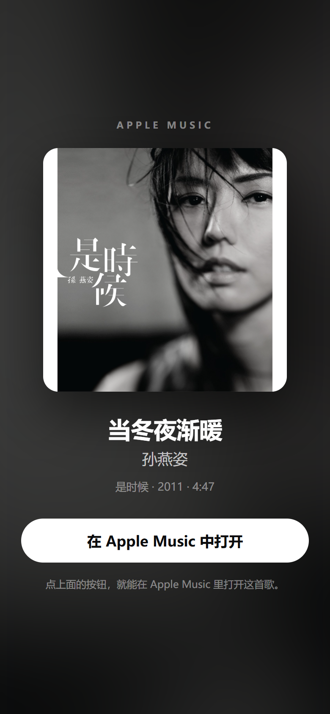
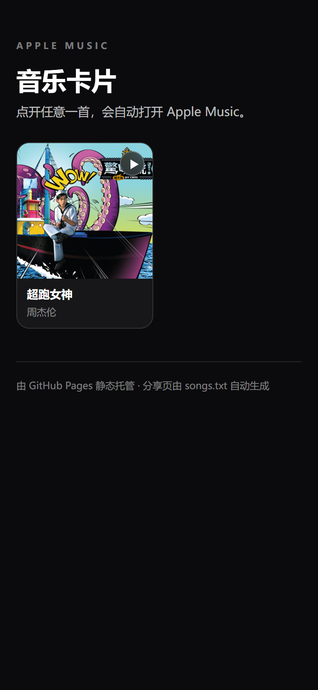

# MusicCard Web · Apple Music 朋友圈分享页

把一首 Apple Music 歌曲变成一个**干净的分享页**：满幅封面、歌名歌手、一个「在 Apple Music 中打开」按钮，外加一张专门排过版的 1200×630 分享图（`og:image`）。

分享到微信朋友圈 / 聊天时，微信抓到的就是这张排好的图，**不再是 Apple 那张「白底 + 中间小封面」的 1200×630**。

<p>
  
  
</p>

- 纯静态：没有后端、没有数据库、不需要服务器、不需要备案。
- 免费：GitHub Pages 托管，公开仓库 0 元。
- 自动：往 `songs.txt` 里加一行链接，提交后 GitHub Actions 自动重新生成。

---

## 一、它解决的是什么问题

在 Apple Music 里把歌分享到微信，微信拿到的是 Apple 的网页，按「普通链接」处理，抓到的 `og:image` 是 Apple 服务端生成的这样一张图：

> 1200×630 的白底画布，中间放一个 430×430 的小封面。

于是朋友圈里就是「小封面 + 一大片空白」。

QQ 音乐、网易云那种「大封面 + 播放键」的卡片，是 App 通过微信开放平台的 SDK（`WXMusicObject`）发出来的，需要企业资质认证（300 元/年）、应用上架审核、自有域名和 Universal Link。个人、自签名 App 走不通这条路。

所以这里的做法是：**自己做一个网页，把分享图提前排好版**，再把这个网页的链接分享到朋友圈。微信抓到的 `og:image` 就是我们排好的图，缩略图裁成方形后正好是封面本身。

---

## 二、5 分钟部署（不需要写代码）

### 1. 准备

- 一个 GitHub 账号（没有就注册：<https://github.com/signup>，免费）。
- 拿到本项目的文件夹（`MusicCard-Web`）。

### 2. 新建仓库

1. 打开 <https://github.com/new>。
2. **Repository name** 填 `music-card`（可以换成你喜欢的名字，记住它后面要用）。
3. 选 **Public**（免费账号的 Pages 只对公开仓库开放）。
4. 点 **Create repository**。

### 3. 把文件传上去

**方式 A：网页上传（最简单）**

1. 在新仓库页面点 **uploading an existing file**。
2. 打开本地的 `MusicCard-Web` 文件夹，把里面的**所有内容**（不是文件夹本身）拖进浏览器。
   - 一定要包含 `.github` 这个文件夹（Windows 默认隐藏以点开头的文件夹：资源管理器 → 查看 → 勾选「隐藏的项目」）。
   - 拖拽上传会保留目录结构。
3. 下面填一句提交说明，点 **Commit changes**。

**方式 B：GitHub Desktop（文件多时更稳）**

1. 安装 <https://desktop.github.com/>。
2. `File → Add local repository`，选 `MusicCard-Web` 文件夹。
3. 点 **Publish repository**，取消勾选 “Keep this code private”。

### 4. 打开 Pages

1. 仓库页 → **Settings** → 左侧 **Pages**。
2. **Build and deployment → Source** 选 **GitHub Actions**（不要选 “Deploy from a branch”）。

### 5. 等它跑完

1. 点仓库顶部 **Actions**。
2. 会看到一条 **Build share pages** 正在跑（黄色小圆点）。
3. 等它变成绿色对勾（第一次大约 1–2 分钟）。

### 6. 打开你的站点

地址是：

```
https://<你的用户名>.github.io/music-card/
```

例如用户名是 `zhangsan`、仓库名是 `music-card`，就是 `https://zhangsan.github.io/music-card/`。

打开后应该看到「音乐卡片」列表页，里面是示例歌曲。

---

## 三、加歌 / 删歌

编辑根目录的 `songs.txt`，一行一个链接：

```text
# 以 # 开头是注释
https://music.apple.com/cn/album/1442430575?i=1442430979
https://music.apple.com/cn/song/1442430979
https://music.apple.com/cn/album/815423735
```

- 支持歌曲页（`?i=` 或 `/song/`）、专辑页（自动取第一首）、`apple.co` 短链。
- 同一首歌写多次会自动去重。
- 改完提交（网页上直接点文件 → 铅笔图标 → 改 → Commit），Actions 会自动重跑。

失败的行不会让整个构建挂掉，Actions 日志里会写「失败：原因」。

---

## 四、分享到朋友圈

1. 在站点列表页点一首歌，进入分享页。
   - 页面会在 0.9 秒后自动跳转 Apple Music；如果不想跳，地址后面加 `#noauto`（截图、检查用）。
2. 复制浏览器地址栏的链接，形如 `https://<用户名>.github.io/music-card/s/1442430979/`。
3. 微信 → 发现 → 朋友圈 → 长按右上角相机图标 → 粘贴链接 → 发表。

微信会抓取这个页面，显示成一张链接卡片：标题是「歌名 - 歌手」，缩略图就是我们排好的封面图。

> 想发满幅大图？用配套的 iOS App **MusicCard** 生成 1600×900 的图片卡片，直接当图片发朋友圈（图片不受链接卡片模板限制）。

### 不想建站？直接生成一张图片卡片

如果只想发图、不想注册 GitHub，可以在电脑上直接生成 1600×900 的卡片（封面 + 歌名 + 歌手 + 二维码），存成 PNG 传到手机发朋友圈即可：

```powershell
python tools/make_song_card.py --track-id 535754673 --out 超跑女神.png

# 或者用分享链接
python tools/make_song_card.py --link "https://music.apple.com/cn/album/535754551?i=535754673" --out 超跑女神.png
```

- 二维码指向 `https://music.apple.com/cn/song/<trackId>`，朋友长按识别会直接在 Apple Music 里打开。
- 封面用 3000×3000 原图；宽幅封面（比如《惊叹号》）会自动往右偏一点裁切，避免切掉专辑标识。
- 输出是 16:9，朋友圈单图按原比例显示；想要 1:1 可以改脚本里的 `WIDTH, HEIGHT`。

### 自检工具

部署完想确认微信能抓到什么，在电脑上运行：

```powershell
python tools/check_meta.py https://<用户名>.github.io/music-card/s/1442430979/
```

它会用微信的 UA 抓一遍页面，打印 `og:title` / `og:image`，并下载分享图确认尺寸。

---

## 五、本地预览（可选）

```powershell
python tools/build_site.py --base-url http://127.0.0.1:8000/
python -m http.server 8000 --directory dist
```

然后浏览器打开 <http://127.0.0.1:8000/>。

生成分享页截图（需要本机 Edge）：

```powershell
python tools/screenshot.py
```

依赖：Python 3.10+、`pillow`；截图脚本额外需要 `playwright`（`pip install playwright`，用本机 Edge，不用下载浏览器）。

---

## 六、目录结构

```text
MusicCard-Web/
├─ songs.txt                     # 你要分享的歌，一行一个链接
├─ assets/style.css              # 页面样式
├─ tools/
│  ├─ build_site.py              # 生成 dist/（查 iTunes、下封面、排版、写 HTML）
│  ├─ make_song_card.py          # 生成一张 1600×900 图片卡片（含二维码），不建站也能发
│  ├─ check_meta.py              # 用微信 UA 检查 og 标签
│  └─ screenshot.py              # 用本机 Edge 截图预览
├─ .github/workflows/build-pages.yml   # 提交后自动构建 + 部署
├─ preview/                      # 预览截图（README 用）
└─ dist/                         # 生成结果，已 gitignore
```

生成的每个歌曲目录里有：

| 文件 | 用途 |
| --- | --- |
| `index.html` | 分享页，含 `og:*` 标签 |
| `og.jpg` | 1200×630 分享图：模糊封面底 + 居中 600×600 封面 + 播放角标 |
| `art.jpg` | 1400×1400 页面大图 |

---

## 七、常见问题

**Q1：打开 `https://<用户名>.github.io/<仓库名>/` 是 404。**
按顺序检查：仓库是 Public；Settings → Pages → Source 是 **GitHub Actions**；Actions 里那次运行是绿色；地址里的用户名/仓库名大小写和实际一致（仓库名区分大小写）。

**Q2：Actions 跑失败了。**
点进失败的那次运行，展开 `Build pages` 看日志。最常见是 `songs.txt` 里某条链接失效或不是 Apple Music 链接——日志会写「失败：没有查到这首歌」。

**Q3：朋友圈里还是不显示图 / 显示旧图。**
微信会缓存链接的抓取结果，同一地址短时间内重复发会拿到旧图。换一首歌的新地址试；或者等几分钟；先用 `tools/check_meta.py` 确认服务器上的 `og:image` 是对的。

**Q4：点开链接后没有自动跳到 Apple Music。**
微信内置浏览器有时会拦截自动跳转。点页面上白色的「在 Apple Music 中打开」按钮即可；仍然没反应就点右上角「···」→ 在 Safari 中打开。

**Q5：封面有点糊。**
页面用的是 1400×1400，分享图里是 600×600，朋友圈缩略图只有一两百像素，正常观看足够。iTunes 最高提供 3000×3000，构建时会优先用。

**Q6：能改成我自己的域名吗？**
可以，但**不必须**，而且自定义域名要花钱（约 30–100 元/年）。做法：域名服务商加一条 CNAME 指向 `<用户名>.github.io`，仓库 Settings → Pages → Custom domain 填域名，再在 `dist/` 里放一个 `CNAME` 文件（当前构建脚本没生成，需要自己加一步）。国内服务器才需要备案，GitHub Pages 在境外，不需要。

**Q7：能不用 GitHub 吗？**
能。`dist/` 是纯静态文件，扔到 Cloudflare Pages、Netlify、Vercel、对象存储都能用；构建那一步在任何能跑 Python 的地方执行一次即可。

**Q8：国内访问 `github.io` 有时候慢、甚至打不开？**
`github.io` 在国内不是 100% 稳定（不同运营商、不同时段不一样）。如果朋友打开很慢：让他换 Wi-Fi / 蜂窝再试；或者用自定义域名（CNAME 到 `<用户名>.github.io`）改善；实在不行就把 `dist/` 部署到别的静态托管。微信抓取页面时如果超时，就只会显示标题、没有图，所以链接能稳定打开很重要。

---

## 八、限制（提前说清楚）

1. **不是微信原生音乐卡片。** 没有播放键、不能在微信里直接播放、点开是浏览器再跳 App。要做成 QQ 音乐那样，只能走微信开放平台资质，个人做不到。
2. **缩略图大小由微信决定。** 我们只能保证「图本身是排好版的封面」，不能保证微信把它显示成多大。
3. **微信不执行 JavaScript。** 所有 `og` 标签必须是构建时写死的静态 HTML，所以每首歌都要提前生成页面——这就是为什么要跑一次构建，而不是一个页面动态取歌。
4. **只支持 Apple Music。** 其它平台各有各的分享方式，不在本项目范围内。
5. **曲库以 Apple 为准。** 中国区没有的曲子会自动去美区/日区等找，元数据可能是英文。

---

## 九、和 iOS App 的关系

| | MusicCard App | MusicCard Web（本项目） |
| --- | --- | --- |
| 产物 | 1600×900 / 1080×1440 / 1080×1080 图片卡片 | 网页链接 |
| 分享方式 | 存相册 → 发图 | 复制链接 → 发链接卡片 |
| 优点 | 满幅、带二维码、样式可选 | 点开能直接跳 Apple Music |
| 需要 | 自签名安装 | 一个 GitHub 账号 |

两个可以一起用：日常发图用 App，想让人点开听用网页。
